<div align="center">

# FeTex

**강남역 1km² 디지털 트윈에서 택시 수요를 예측하고, 빈 택시를 배차·재배치하는 시뮬레이션 플랫폼**

과제 12 「28_DT_카카오모빌리티 — 택시 수요 예측 및 동적 배차」 · FeTex 6팀

<br>


[**통합 보고서**](REPORT.md) &nbsp;·&nbsp; [**결과 요약표**](docs/RESULTS_SUMMARY.md) &nbsp;·&nbsp; [**RL 실험 결과**](https://github.com/fetex-Team/Fetex/blob/jwy/taxi55_experiment/README.md) &nbsp;·&nbsp; [**설계 결정 기록**](docs/design/README.md) &nbsp;·&nbsp; [**설치 · 실행**](#설치--실행)

</div>

<br>

<p align="center">
  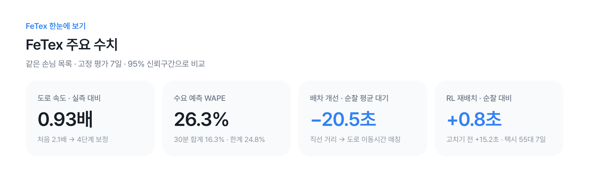
</p>

FeTex는 SUMO로 만든 **강남역 1km² 디지털 트윈**입니다. 국토교통부 TIMS 2025 격자별 승차 실측, 서울시 2025 교통 통계, 실측 시간별 날씨로 보정한 택시 호출을 흘려 보내고, **H3 격자별 10~60분 앞 수요를 XGBoost로 예측**합니다. 손님과 택시는 **도로 이동시간 기준 헝가리안 매칭**으로 짝짓고, 빈 택시는 순찰 · 시간표 선배치 · 예측 재배치 · **강화학습(PPO)** 으로 재배치합니다. 모든 전략은 **같은 손님 목록**에서 고정 7일 동안 비교하고, 결과는 Unity 3D와 웹 대시보드로 확인합니다.

<br>

<div align="center">

[한눈에 보는 결과](#한눈에-보는-결과) · [프로젝트 소개](#프로젝트-소개) · [시스템 아키텍처](#시스템-아키텍처) · [Module 1](#module-1--디지털-트윈) · [Module 2](#module-2--시공간-데이터-처리) · [Module 3](#module-3--수요-예측)<br>
[Module 4](#module-4--배차--재배치--호출비) · [보너스: 강화학습](#보너스--강화학습-재배치-택시-55대) · [민감도](#민감도--무엇이-결과를-좌우하나) · [시각화](#시각화--unity--대시보드) · [검증 · 재현성](#검증--재현성) · [한계](#한계와-다음-단계) · [설치 · 실행](#설치--실행) · [문서](#문서)

</div>

<br>

## 한눈에 보는 결과

| 항목 | 결과 | 조건 |
|---|---|---|
| 도로 현실화 | 시뮬레이션 도로 속도 실측 대비 **2.1배 → 0.93배** (평균 절대 오차율 18%) | TOPIS, 보정에 안 쓴 평가 7일 |
| 수요 예측 (XGBoost, t+1~t+6) | 시험 WAPE **26.3%**, 앞으로 30분 합계 **16.3%** (나이브 36.2%, 잡음 한계 24.8%) | H3 res 8 · 10분 칸 |
| 배차 개선 (직선 거리 → 도로 이동시간) | 순찰 7일 평균 대기 **80.6초 → 60.1초** (시간표 선배치 −16.9초, RL −15.7초) | 택시 50대 · 팀 기본 설정 |
| 전략 비교 (근거기반 현실화) | 서비스율 순찰 **95.7%** · 예측 재배치 95.8% · 선배치 95.5% · RL 95.7% → 차이 **0.3%p 안** | 택시 61대 · 7일 |
| 강화학습 재배치 | 순찰 대비 평균 대기 **+15.2초 → +0.8초** (95% CI −1.8 ~ +3.3), 못 탄 손님 340명 → 327명 / 일 | 택시 55대 · 7일 |
| 민감도 | 택시 61 → 50대 **−21.1%p**, 밖으로 나간 택시 늦게 복귀 **−22.1%p**, 손님 쪽 가정 ±2.3%p 안 | 순찰 서비스율 · 평일 3일 |
| 재현성 | 같은 설정 두 번 실행 시 날짜별 평균 대기가 **소수점까지 동일** | 해시 시드 · 수요 지문 고정 |
| Unity 재생 | 회전 구간 도로 이탈 **56% → 0.6%**, 재생 파일 **48MB → 8MB** | 교차로 내부 차선 기록 |

> [!IMPORTANT]
> 실험 조건이 세 가지라 **조건이 다른 숫자끼리는 비교하지 않습니다.** 같은 조건 안에서 전략끼리 비교한 결과만 씁니다.
>
> | 조건 | 택시 | 도로 | 쓰인 곳 | 순찰 평균 대기 |
> |---|---:|---|---|---:|
> | 팀 기본 설정 | 50대 | SUMO 기본 (빠른 도로) | 배차 개선, 예측 재배치 개발 | 약 60초 |
> | 근거기반 현실화 프리셋 | 61대 | 실제 신호 · 속도 · 버스차로 | 디지털 트윈 최종 평가, 민감도 | 약 153초 |
> | RL 실험 | 55대 | 근거기반 현실화와 같음 | 보너스: 강화학습 | 약 191초 |

<br>

## 프로젝트 소개

강남역 금요일 밤처럼 특정 시간·장소에 몰리는 택시 호출을 예측하고, 한정된 택시를 알맞은 곳에 보내는 **동적 배차**를 디지털 트윈에서 검증하는 과제입니다. 실제 카카오 T 호출 로그 대신 **공개 실측 데이터**(과제 제약 허용 범위)로 수요 · 도로 · 신호 · 승차 위치를 맞췄습니다.

| 모듈 | 과제가 요구하는 것 | FeTex |
|---|---|---|
| Module 1 디지털 트윈 | 도시 교통 환경, 택시 · 승객 이동 재현 | SUMO + 실제 강남역 도로망 · 신호 · TOPIS 속도 |
| Module 2 시공간 데이터 처리 | 격자 변환, 시간 분해, 외부 데이터 결합, 시차 피처 | H3 res 8 · 10분 칸, 날씨 · 공휴일 결합, 피처 43개 |
| Module 3 수요 예측 | 향후 30분 호출 예측, RMSE · MAPE 평가 | XGBoost(demand_v2), CNN-LSTM, 장소 종류별 모델 |
| Module 4 동적 배차 · 인센티브 | 수급 불균형 지표, Surge, 적용 전후 효과 검증 | 헝가리안 매칭, 재배치 전략, 동적 호출비 |
| 보너스 | 강화학습 기반 배차 최적화, 대시보드 | PPO 재배치, Unity 3D 재생, 웹 대시보드 |

### 설계 원칙

<table>
  <tr>
    <td width="50%" valign="top">
      <b>같은 손님, 다른 전략</b><br>
      하루 호출 목록을 날짜별 고정 난수로 먼저 만듭니다(외생 수요). 같은 날짜면 모든 전략의 <b>수요 지문</b>이 같아서, 결과 차이를 전략 차이로 읽을 수 있습니다.
    </td>
    <td width="50%" valign="top">
      <b>모든 설정값에 근거</b><br>
      설정 <b>42개</b>의 출처와 근거 등급을 <a href="docs/design/08_evidence_register.md">근거 대장</a>에 기록하고, 설정과 대장이 일치하는지 자동 테스트로 검사합니다.
    </td>
  </tr>
  <tr>
    <td width="50%" valign="top">
      <b>미래를 보지 않는 예측</b><br>
      시간순 학습 70% / 검증 10% / 시험 20%, 분할 경계 6칸 비움, 날씨는 그 시각 이전 관측만 결합합니다.
    </td>
    <td width="50%" valign="top">
      <b>학습 · 검증 · 평가 날짜 분리</b><br>
      설정값과 저장본은 검증 날짜로만 고르고, 고정 평가 7일에서 날짜를 짝지어 95% 신뢰구간과 부호 검정으로 판단합니다.
    </td>
  </tr>
</table>

<br>

## 시스템 아키텍처

<p align="center">
  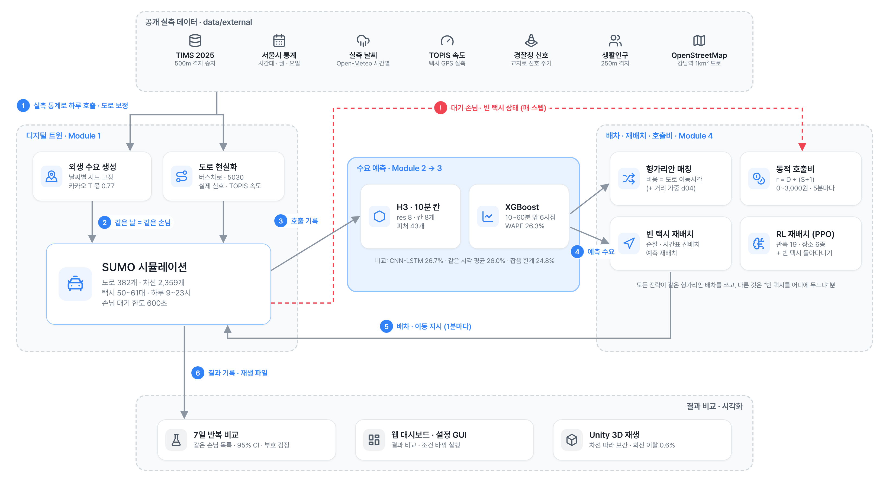
</p>

| 단계 | 하는 일 | 주요 파일 |
|:---:|---|---|
| ① | 실측 통계로 하루 호출 목록을 만들고, 실제 신호 · TOPIS 속도로 도로를 보정 | `data/loaders/`, `module1_simulation/demand_model.py` |
| ② | 같은 날짜 = 같은 손님 목록으로 SUMO 실행 (TraCI) | `measure_wait_time.py`, `module1_simulation/` |
| ③ | 호출 기록을 H3 칸 · 10분 단위로 정리, 피처 43개 생성 | `module2_preprocessing/` |
| ④ | 칸별 10~60분 앞 호출 예측 (XGBoost), 장소 종류별 예측 (RL 입력) | `module3_prediction/` |
| ⑤ | 헝가리안 매칭 · 빈 택시 재배치 · 동적 호출비를 1분 / 5분마다 시뮬레이션에 반영 | `module4_dispatch/` |
| ⑥ | 7일 반복 비교 · 대시보드 · Unity 재생 파일 | `module4_dispatch/experiments/`, `dashboard/`, `module1_simulation/unity/` |
| ! | 매 스텝 대기 손님 · 빈 택시 상태를 Module 4로 전달 | `module1_simulation/taxi_manager.py` |

<details>
<summary><b>폴더 구조</b></summary>

```text
Fetex/
├── main.py                 실행 진입점 (play / train / compare / unity / analyze / dashboard)
├── config_gui.py           설정 GUI (값 편집 · 프리셋 · 학습 · A/B 비교 · 모델 세트)
├── config_loader.py · config_schema.py   설정 로더 · GUI 항목 정의
├── measure_wait_time.py    공용 시뮬레이션 실행 · 측정 루프
├── data/
│   ├── loaders/            실측 통계 → 호출 로그, 날씨 · 신호 · TOPIS · 생활인구 · 기종점 추출
│   └── external/           TIMS, 서울시 통계, 실측 날씨, 생활인구 250m, 택시 통행량 · 기종점, TOPIS, 신호 계획
├── module1_simulation/     디지털 트윈 (지도 · 수요 · 택시/승객 매니저 · 신호 · 속도 배율)
│   ├── unity/              Unity 재생 파일 내보내기 · 궤적 복원 · 검사
│   └── checks/             지도 경고 · 회전 금지 · 날씨 출처 · TOPIS 속도 · 기종점 통행시간 검증
├── module2_preprocessing/  H3 인덱싱 · 시계열 피처 · 외부 데이터 병합 · POI · EDA
├── module3_prediction/     train · evaluate · h3_predictor · category_predictor · tune_xgb
├── module4_dispatch/       헝가리안(거리 가중 · 적응형) · 재배치 · RL(PPO) · 동적 호출비
│   └── experiments/        A/B 비교 · 7일 반복 · 택시 대수 산정 · 재현성 검사
├── taxi55_experiment/      택시 55대 RL 재학습 · 저장본 고르기 · 7일 비교 스크립트와 결과표
├── dashboard/              결과 대시보드 (Flask)
├── tools/                  수요 로그 분석기 · 런타임 검증 · 모델 세트 · 타임라인 선택
├── tests/                  단위 · 통합 테스트
├── presets/                팀 프리셋(default/) · 개인 프리셋(user/)
├── saved_models/           demand_v2.joblib · cnn_lstm_demand.pt · category_demand_*.pkl
├── results/                eda · module3 · repeat · ab_results · unity_replay · topis_speed ...
└── docs/                   설계 결정(design/) · 검증 · 계산식 · 대시보드 문서
```

</details>

<br>

## Module 1 — 디지털 트윈

<p align="center">
  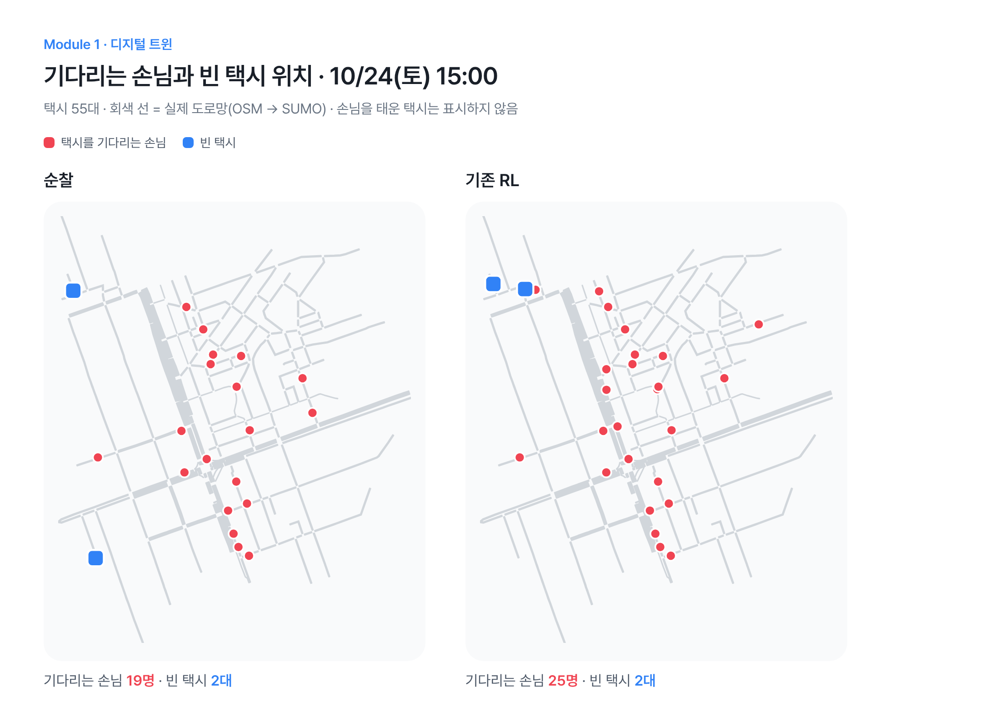
</p>

- **지도**: 강남역 중심 약 1.0km × 1.0km, OpenStreetMap → SUMO. 철도 · 수로를 지우고 양방향 통행 도로만 남겨 **도로 382개 · 차선 2,359개**
- **POI 구역**: 학교 4 · 주거 28 · 회사 47 · 음식점 150 · 지하철 출구 14 · 버스정류장 26 · 백화점 3 — 손님 분류와 시간표 선배치 · RL 구역에 사용
- **수요**: 하루 호출 = Σ TIMS 격자(그달 하루 평균 × 겹친 면적) × 강남구 월별 배율 × 요일 배율 × **카카오 T 몫 0.77** (앱 호출 약 80% × 점유율 약 96%), 시간마다 포아송 과정, 강수 1mm당 +1.99%
- **근거기반 현실화 프리셋**: 승차 위치 = 생활인구(250m) 비례, 택시 **61대**, 손님 대기 한도 **600초**, 구역 안 하차 **5.4%**
- SUMO 변환 경고 271건 중 90건이 실제 영향(회전 금지 무시 등)이고 원인은 OSM 원본 품질이라, 대기시간 절대값은 현실과 비교하지 않고 **같은 조건의 전략 간 비교**로만 씁니다

### 도로 현실화

<p align="center">
  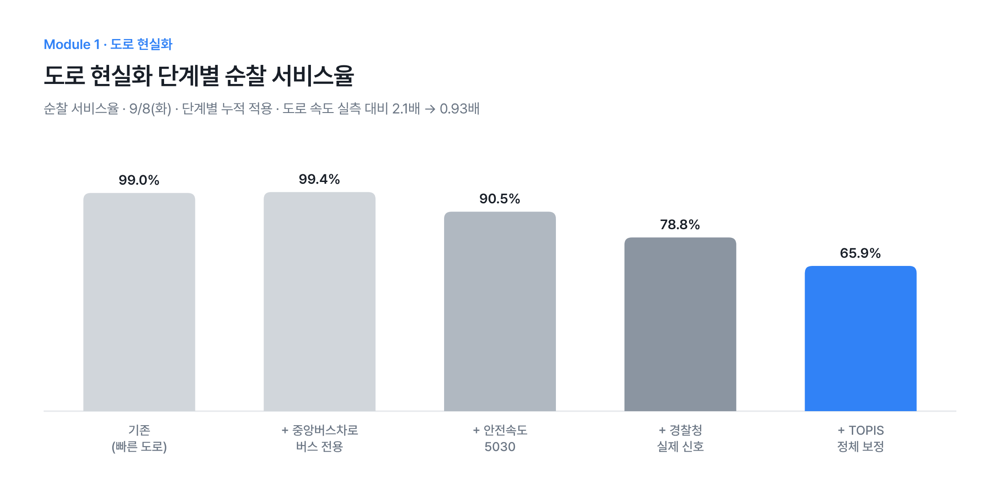
</p>

| 단계 | 바꾼 것 | 근거 | 순찰 서비스율 (9/8, 택시 50대, 누적) |
|---|---|---|---:|
| 기존 | SUMO 기본 (간선 100km/h 등) | — | 99.0% |
| ① | 강남대로 중앙버스차로를 버스 전용으로 | 서울 중앙버스전용차로 24시간 운영 | 99.4% |
| ② | 제한속도를 안전속도 5030으로 | 2021-04-17 시행 | 90.5% |
| ③ | 강남역 · 교보타워 사거리 실제 신호 주기 (140~170초) | 경찰청 교차로 신호 운영계획 | 78.8% |
| ④ | 시간대 · 요일별 도로 속도 보정 | 서울시 TOPIS 택시 GPS 실측 속도 | 65.9% |

<p align="center">
  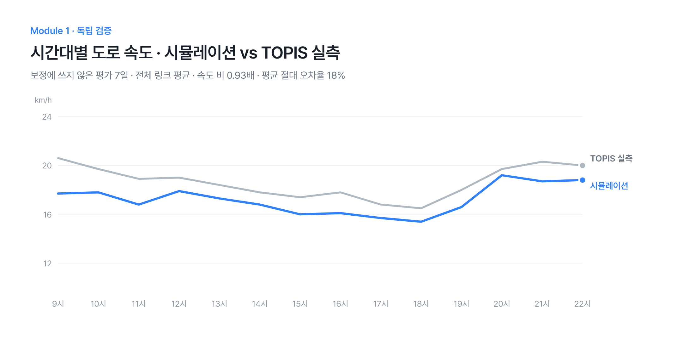
</p>

| 독립 검증 (보정에 안 쓴 자료) | 결과 | 비교 기준 |
|---|---|---|
| 도로 속도 | 실측의 **0.93배**, 평균 절대 오차율 18% (1,309칸) | TOPIS, 평가 7일 |
| 배차 예상 이동시간 | 실제의 **0.81배** (평균 2.6분 vs 3.2분) | 한국교통연구원 택시 기종점 통행시간, 90개 칸 쌍 |
| 탑승 성공률 (택시 61대) | **95.7%** | 카카오모빌리티 2025 상반기 발표 약 94% |
| 수요 생성 | 8주 446,712건, 일별 (생성 − 기대) / √기대 평균 0.17 · 표준편차 1.04 | 포아송 분포 |

<br>

## Module 2 — 시공간 데이터 처리

- 8주(2026-07-13 ~ 09-06) **446,712건**, 56일 모두 실측 시간별 날씨 연결
- 10분 칸 집계(호출 0인 칸 보존) → **피처 43개**: 지난 1~6칸, 이동평균 · 표준편차, 어제 · 지난주 같은 칸, 달력 15개(시각 · 요일 · 공휴일 · 연휴 앞뒤), 날씨와 파생(3시간 누적 강수, 연속 강수 시간, 24시간 기온 편차)
- 날씨는 `merge_asof(backward)`로 그 시각 이전 관측만 결합하고, 품질 기준(범위 · 결측률 5% 이하 · 중복 없음 · 공휴일 달력 범위)을 어기면 학습을 멈춤
- 좌표 → H3 변환은 고유값 캐시와 묶음 처리로 10만 행 0.42초 (한 줄씩 처리 대비 2.3배), Geohash 지원 · Module 2 자동 테스트 **85개**

| H3 해상도 | 칸 수 | 호출 0인 칸 | 직전 칸과의 상관 | 판단 |
|:---:|---:|---:|---:|---|
| 7 | 3 | 15% | 0.53 | 한 칸에 86% 몰림 |
| **8** | **8** | **28%** | **0.39** | **채택** — 실측 원천(TIMS)이 500m 격자 |
| 9 | 29 | 44% | 0.21 | 0인 칸이 많음 |
| 10 | 98 | 60% | 0.10 | 대부분 잡음 |

<p align="center">
  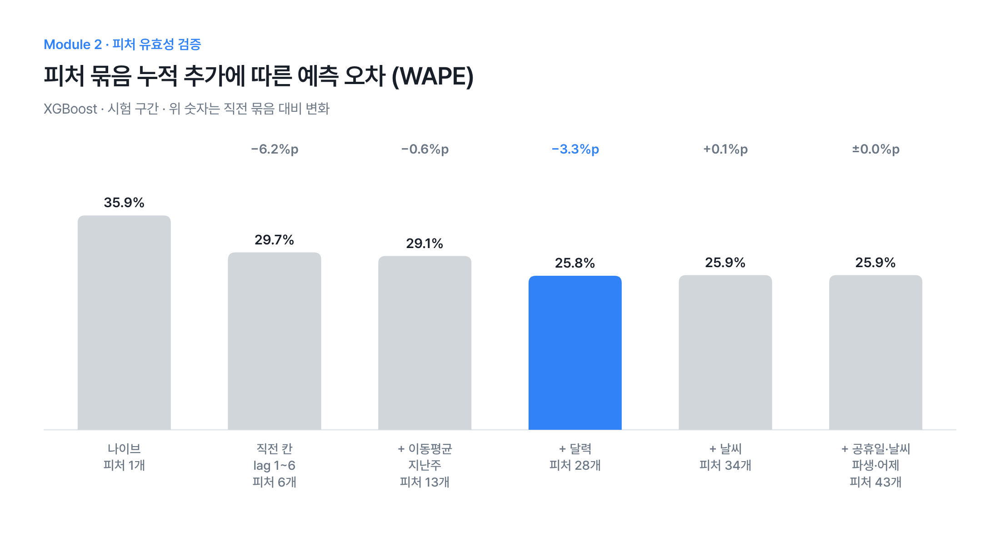
</p>

<p align="center">
  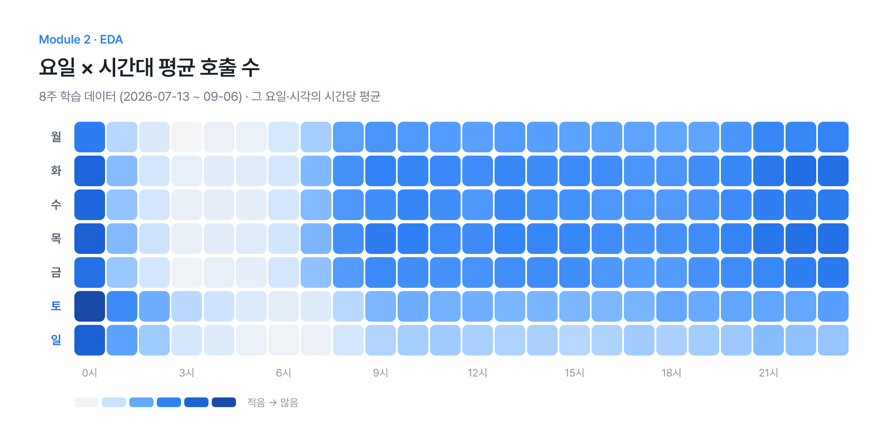
</p>

| EDA 항목 (8주, 하루 24시간) | 결과 |
|---|---|
| 평일 / 주말 / 공휴일 하루 평균 | 8,511 / 6,817 / 6,697건 (주말은 평일보다 약 20% 적음) |
| 칸 집중 | 강남역 사거리 칸 하나가 전체의 **46.7%**, 상위 4칸이 약 96% |
| 날씨 | 시간당 5mm 넘게 오면 호출 **1.34배**, 기온은 0.98~1.02배 |
| 정상성 (ADF) | 원계열 −16.3, 1차 차분 −20.0 (1% 기준 −3.43) → 차분 없이 사용 |
| 자기상관 | 직전 칸 0.20, 1시간 0.17, 하루 전 0.16, 1주 전 0.17 — **48칸(4시간)까지 유의** |

<br>

## Module 3 — 수요 예측

<p align="center">
  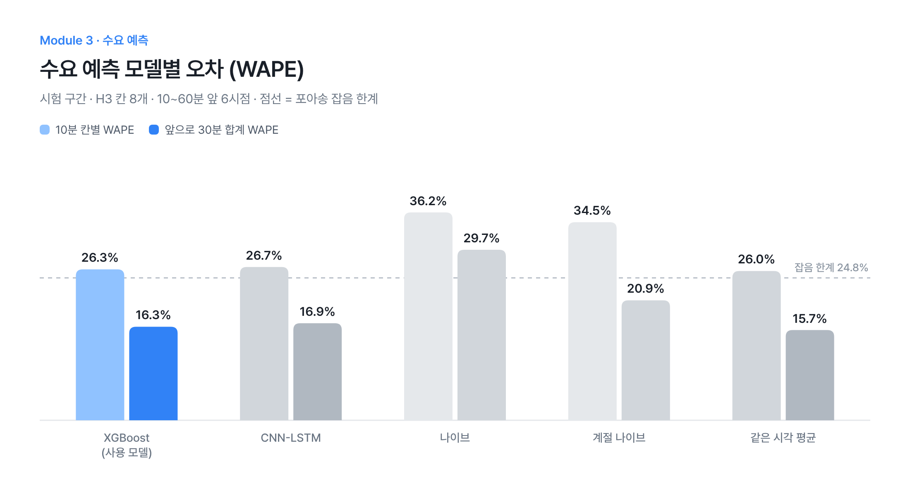
</p>

| 모델 (10분 칸, 시험 구간) | WAPE | 30분 합계 WAPE | RMSE | MAE |
|---|---:|---:|---:|---:|
| **XGBoost (`demand_v2`, 사용 모델)** | **26.3%** | **16.3%** | 2.81 | 1.77 |
| CNN-LSTM (직전 6칸 시퀀스) | 26.7% | 16.9% | 2.88 | 1.80 |
| 나이브 (마지막 끝난 칸) | 36.2% | 29.7% | 4.11 | 2.43 |
| 계절 나이브 (지난주 같은 시각) | 34.5% | 20.9% | 3.83 | 2.32 |
| 같은 시각 평균 | 26.0% | 15.7% | 2.80 | 1.75 |
| (참고) 포아송 잡음 한계 | 24.8% | — | 2.63 | — |

- MultiOutput XGBoost로 t+1~t+6(10~60분 앞)을 한 번에 예측 · 깊이 6, 학습률 0.025, 나무 200개 · CNN-LSTM은 11번째 에포크 조기 종료
- XGBoost가 "같은 시각 평균"과 같은 수준인 이유: 호출을 실측 **통계**(시간대 · 요일 · 월 비율) + 포아송 잡음으로 만들어, 기대 수요가 "칸 × 요일 종류 × 시각"으로 거의 정해지기 때문입니다. 잡음 한계와의 차이가 1.5%p라 이 데이터로는 줄일 여지가 거의 없습니다
- 주 지표가 WAPE인 이유: 호출 0건 칸이 많아 MAPE는 계산이 불안정 (MAPE 36.6%, 2건 이상 칸만 35.3%)

| 쪼개 본 기준 | 결과 |
|---|---|
| 예측 시점 | 10분 뒤 26.2% ~ 60분 뒤 26.4% |
| 시간대 | 낮 · 저녁 22~28%, 새벽 3~5시 33~38% |
| 칸 | 호출 많은 4칸(전체의 96%) 17~36%, 강남역 사거리 칸 17% |
| 과제 기준 5분 단위 | 칸별 36.0%, **30분 합계 16.4%** |

예측은 예측 재배치(다음 30분), 동적 호출비(다음 5분), RL 관측(장소 종류별 예측 수요)에 쓰입니다.

<br>

## Module 4 — 배차 · 재배치 · 호출비

### 배차: 도로 이동시간 기준 헝가리안 매칭

```
비용(택시 i, 손님 j) = 도로망 최단 이동시간(다익스트라, 초) + w × 직선 거리(m)      (기본 w = 0)
```

<p align="center">
  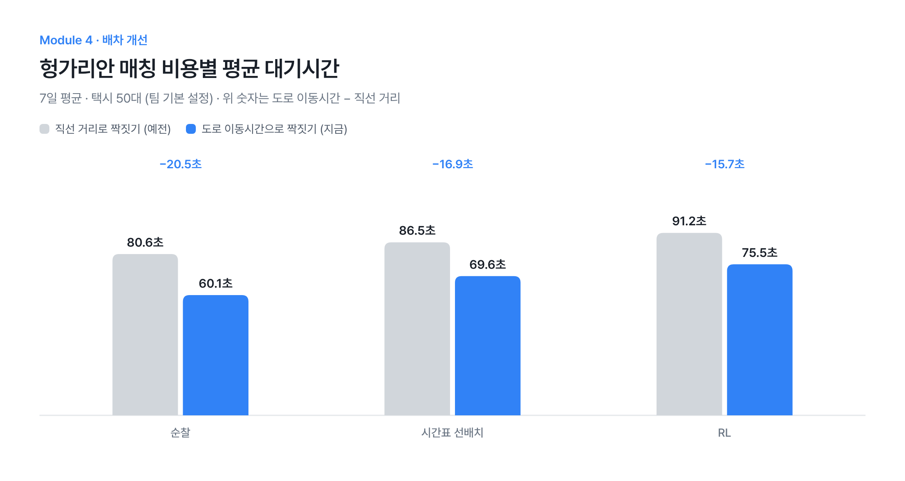
</p>

- 대기 손님 전체와 빈 택시 전체를 한 번에 짝짓고, **모든 전략이 같은 배차**를 씁니다. 전략마다 다른 것은 "빈 택시를 어디에 두느냐"뿐입니다
- 무작위 300건 중 직선으로 가장 가까운 택시가 도로로 가장 빠른 택시와 **다른 경우가 40%** (그때 평균 17초 손해) → 시작할 때 도로 406개 사이 최단 시간을 미리 계산(0.4초), 갈 수 없는 조합은 배정하지 않음 (7일 동안 0건)

### 빈 택시 재배치 · 동적 호출비

| 전략 | 동작 |
|---|---|
| 순찰 `patrol` | 빈 택시가 지역 안의 아무 도로나 골라 계속 이동 |
| 시간표 선배치 `prepositioned` | 장소 종류별 피크 시간표를 보고 미리 보냄 |
| 예측 재배치 `forecast` | 5분마다 칸별 다음 30분 예측 λ에 비례해 빈 택시를 **λ^(2/3)** 비율로 배치, 3분 안에 갈 수 있는 곳만, 빈 택시 30% 미만이면 중단 (기준은 검증 날짜 9/8 · 9/17로 결정) |
| RL 재배치 `rl_prepositioned` | PPO 정책이 1분마다 장소 종류 6가지별 빈 택시 수를 정함 (아래 보너스) |
| `surge` | 기사 인센티브(호출비 × 80%)가 500원 이상인 칸으로 이동 |

```
수급 불균형  r = (지금 대기 손님 + 다음 5분 예측 호출) ÷ (빈 택시 + 1)      칸마다 · 5분마다
호출비       = 1,000원 × (r − 1) → 500원 단위 내림, 0 ~ 3,000원 (미터 요금은 그대로, 기사 80% · 플랫폼 20%)
```

| 전략 (근거기반 현실화, 택시 61대, 7일) | 서비스율 | 평균 대기 | 순찰 대비 |
|---|---:|---:|---|
| 순찰 | **95.7%** | 152.7초 | 기준 |
| 예측 재배치 | **95.8%** | 154.3초 | +1.6초 (95% CI에 0 포함) |
| 시간표 선배치 | 95.5% | 165.8초 | +13.1초 (95% CI +5.3 ~ +20.8) |
| RL (돌아다니기 적용 전) | 95.7% | 180.2초 | +27.5초 (95% CI +11.0 ~ +43.9, 7일 모두 김) |

### 거리 가중 헝가리안 (`hungarian_dNN`)

<p align="center">
  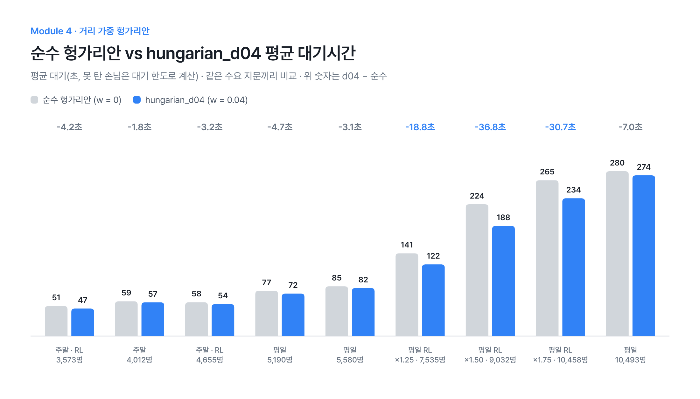
</p>

비용에 `w × 직선 거리`를 더한 배차(`hungarian_d04` = w 0.04)를 A/B 요청 25건 · 조합 194개로 비교했습니다 (11/22~11/26, 지표는 못 탄 손님을 대기 한도로 계산한 평균 대기, 같은 수요 지문끼리만 비교). 9개 실험 모두 `d04`의 대기시간이 순수 헝가리안보다 짧았고, 차이는 −1.8초 ~ −36.8초입니다.

<details>
<summary><b>실험별 상세 · 적응형 · 음수 가중치</b></summary>

| 시뮬 날짜 | 환경 | 승객 | 순수 헝가리안 | `d04` | 차이 | 못 탄 손님 (순수 → d04) |
|---|---|---:|---:|---:|---:|---:|
| 09-24 | 주말 · RL | 3,573명 | 51.1초 | 46.9초 | −4.2초 (−8.2%) | 9 → 9명 |
| 10-24 | 주말 | 4,012명 | 59.2초 | 57.4초 | −1.8초 (−3.0%) | 19 → 17명 |
| 09-20 | 주말 · RL | 4,655명 | 57.6초 | 54.4초 | −3.2초 (−5.6%) | 14 → 22명 |
| 09-16 | 평일 | 5,190명 | 77.0초 | 72.3초 | −4.7초 (−6.1%) | 48 → 29명 |
| 09-01 | 평일 | 5,580명 | 84.8초 | 81.7초 | −3.1초 (−3.7%) | 32 → 27명 |
| 09-07 | 평일 · RL · 수요 ×1.25 | 7,535명 | 140.9초 | 122.1초 | −18.8초 (−13.3%) | 329 → 182명 |
| 09-07 | 평일 · RL · 수요 ×1.50 | 9,032명 | 224.3초 | 187.5초 | −36.8초 (−16.4%) | 1,643 → 796명 |
| 09-07 | 평일 · RL · 수요 ×1.75 | 10,458명 | 265.2초 | 234.5초 | −30.7초 (−11.6%) | 3,129 → 2,136명 |
| 11-16 | 평일 | 10,493명 | 280.5초 | 273.5초 | −7.0초 (−2.5%) | 3,535 → 3,282명 |

- 실험별 1위 가중치는 0.02~0.06 사이였고, `d04`와 1위의 차이는 최대 5.4초(4.6%)
- 고정 `d04` vs 적응형 `adaptive_hungarian` (같은 수요 지문 6개 실험): 차이 0.1~2.3초 (2.8% 이내), `d04` 2번 · 적응형 4번 앞섬. 적응형 v3는 9,032명 실험에서 278.2초 (순수 227.7초)
- 음수 가중치: 11-03 평일 11,107명에서 −0.01~−0.10 모두 순수(288.4초)보다 김 (+5.9 ~ +40.0초), 10-13 평일 5,087명에서는 −0.01이 79.6초로 순수(88.3초)보다 짧음. −0.08 · −0.10은 두 실험 모두 김 (최대 +65.0초)
- 조합마다 1회 실행한 비교이고, 고정 7일 반복 검증은 아직입니다. 팀 기본 프리셋의 `taxi_dispatch_algorithm`은 `hungarian`입니다
- 원자료: KJS 브랜치 `results/ab_results/ab_ranking_202611{22~26}_*.txt`

</details>

<br>

## 보너스 — 강화학습 재배치 (택시 55대)

| 항목 | 값 |
|---|---|
| 조건 | 「근거기반_현실화」 프리셋 + **택시 55대** (순찰 서비스율 85~94%, 전략 차이가 드러나는 구간) · 하루 9~23시 |
| 관측 · 행동 | 장소 종류별 대기 손님 · 빈 택시 · 예측 수요 + 시각 (숫자 19개) → 장소 종류 6가지마다 빈 택시 0~3단계 |
| 보상 ① `default` | 태우면 +3, 대기 손님 1명당 −0.1, 놓치면 −8, 빈 이동 거리 감점, 시간표와 비슷하면 +0.5 |
| 보상 ② `gravityVer` | 항목별 점수 상한(−3 ~ +3)으로 한쪽 쏠림 방지 |
| 학습 | PPO (Stable-Baselines3), 시뮬레이션 4개 동시, **9만 스텝**(1스텝 = 1분) × 보상 2종, 보상당 약 1시간 45분 (CPU 8코어) |
| 날짜 | 학습 5/18 ~ 9/6 평일 · 저장본 고르기 9/15 · 9/30 · 10/21 · **평가 7일** 9/7 · 9/10 · 9/18 · 10/13 · 10/14 · 10/18(일) · 10/24(토) |
| 저장본 | 3만 · 5만 · 7만 · 9만 스텝 차이 1~3초 안 → default 7만 스텝(286.2초), gravityVer 3만 스텝(285.9초) 선택 |

<p align="center">
  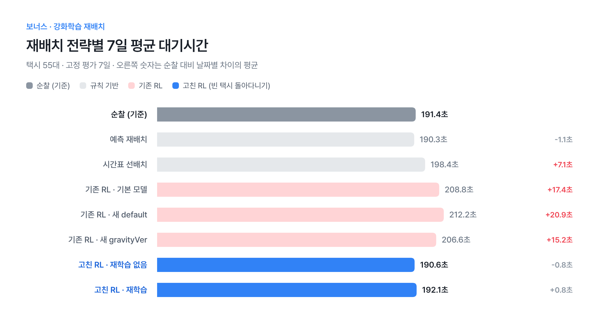
</p>

| 전략 (7일 평균) | 평균 대기 | 순찰 대비 (95% CI) | 서비스율 | 못 탄 손님 / 일 | 불균형 비율 |
|---|---:|---|---:|---:|---:|
| 순찰 (기준) | 191.4초 | — | 93.2% | 328.7명 | 48.9% |
| 예측 재배치 | 190.3초 | −1.1초 (−2.3 ~ +0.2) | 93.2% | 328.3명 | 48.4% |
| 시간표 선배치 | 198.4초 | +7.1초 (+0.2 ~ +13.9) | 93.0% | 337.3명 | 50.0% |
| RL · 기본 모델 (61대로 학습) | 208.8초 | +17.4초 (+0.1 ~ +34.7) | 92.9% | 341.9명 | 51.5% |
| RL · 새 default | 212.2초 | +20.9초 (+1.0 ~ +40.7) | 92.9% | 341.3명 | 52.1% |
| RL · 새 gravityVer | 206.6초 | +15.2초 (+1.2 ~ +29.2) | 93.0% | 339.9명 | 51.6% |
| RL + 돌아다니기 (재학습 없음) | 190.6초 | −0.8초 (−3.9 ~ +2.3) | 93.0% | 339.0명 | 49.1% |
| **RL + 돌아다니기 (재학습 3만 스텝)** | **192.1초** | **+0.8초 (−1.8 ~ +3.3)** | **93.2%** | **326.7명** | **49.4%** |

### 원인 찾기

<p align="center">
  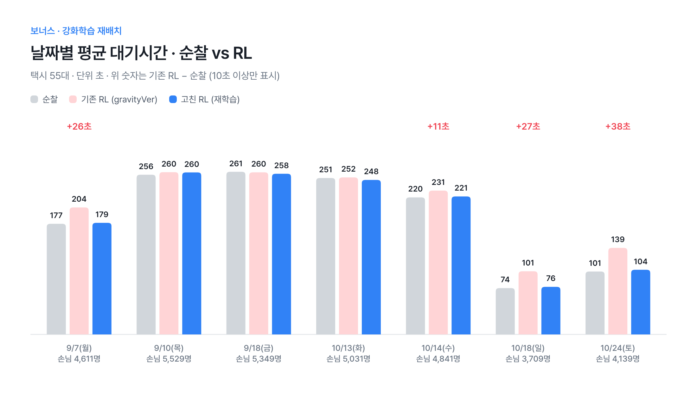
</p>

기존 RL(gravityVer)과 순찰의 날짜별 차이는 손님이 많은 9/10 · 9/18 · 10/13에서 −0.8 ~ +4.1초, 손님이 적은 9/7 · 10/18(일) · 10/24(토)에서 +26.2 ~ +38.0초입니다. 시간대별(9~22시)로는 모든 시간대에서 3.9 ~ 21.8초 길었습니다.

<p align="center">
  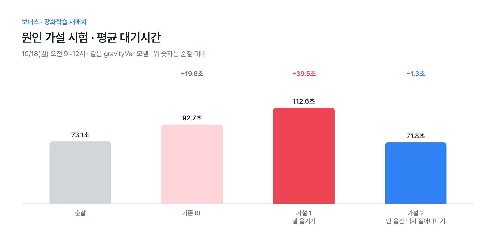
</p>

| 시험 (10/18 일, 9~12시) | 평균 대기 |
|---|---:|
| 순찰 | 73.1초 |
| 기존 RL | 92.7초 |
| 가설 1: RL이 택시를 덜 옮기게 (`rl_max_move_ratio`) | 112.6초 |
| 가설 2: RL이 옮기지 않은 빈 택시를 순찰처럼 돌아다니게 (`rl_idle_roam`) | **71.8초** |

기존 RL은 1분마다 장소 종류별로 **모자란 만큼만** 옮기고, 뽑히지 않은 빈 택시는 손님을 내려 준 곳 근처에 머물렀습니다. `rl_idle_roam=true`에서는 RL이 보내는 중인 택시는 건드리지 않고, **도착했거나 뽑히지 않은** 빈 택시만 순찰처럼 지역 전체를 돌아다닙니다 (이중 제어 방지 유지).

<p align="center">
  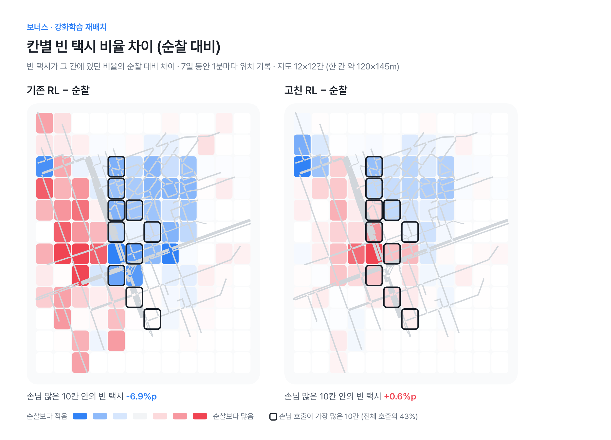
</p>

| 손님 호출이 가장 많은 10칸 (전체 호출의 43%) | 그 10칸에 있던 빈 택시 비율 |
|---|---:|
| 순찰 | 16% |
| 기존 RL (gravityVer) | **9%** |
| RL + 돌아다니기 (재학습) | 16% |

<p align="center">
  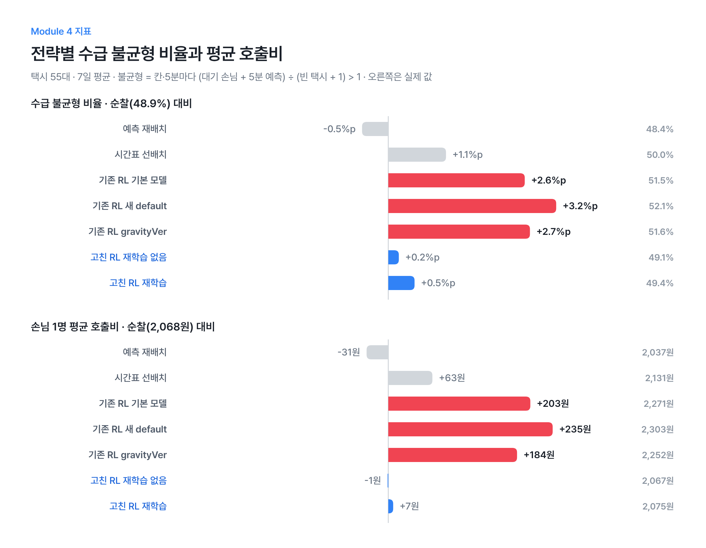
</p>

| 전략 | 불균형 비율 | 평균 호출비 | 호출비 낸 손님 | 빈 택시 비율 | 추정 매출 / 일 |
|---|---:|---:|---:|---:|---:|
| 순찰 | 48.9% | 2,068원 | 77.3% | 15.1% | 71,547,331원 |
| 기존 RL (gravityVer) | 51.6% | 2,252원 | 82.6% | 13.1% | 71,372,746원 |
| RL + 돌아다니기 (재학습) | 49.4% | 2,075원 | 77.9% | 14.9% | 71,554,314원 |

- 평가 7일은 날짜가 7개뿐이라 부호 검정은 7일을 **모두** 이기거나 져야 p < 0.05 (최소 0.016)가 됩니다. 그래서 95% 신뢰구간을 주로 봤습니다
- 지금 RL 모델(`module4_dispatch/rl_reposition_model.zip`)은 돌아다니기 환경에서 재학습한 모델이고, 팀 기본 프리셋의 `rl_idle_roam`은 `true`입니다
- 상세: [taxi55_experiment/README.md](https://github.com/fetex-Team/Fetex/blob/jwy/taxi55_experiment/README.md) · [결과_7일비교.md](https://github.com/fetex-Team/Fetex/blob/jwy/taxi55_experiment/결과_7일비교.md) · [결과_돌아다니기.md](https://github.com/fetex-Team/Fetex/blob/jwy/taxi55_experiment/결과_돌아다니기.md) · [결과_저장본고르기.md](https://github.com/fetex-Team/Fetex/blob/jwy/taxi55_experiment/결과_저장본고르기.md)

<br>

## 민감도 — 무엇이 결과를 좌우하나

<p align="center">
  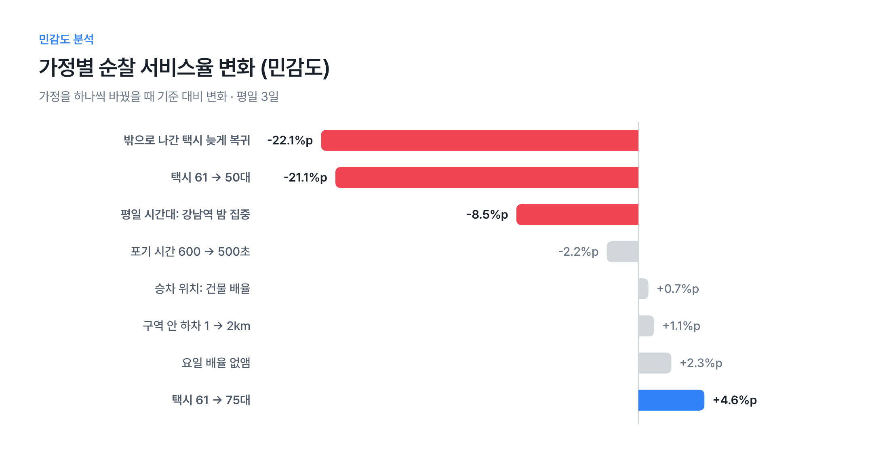
</p>

| 바꾼 것 (순찰, 평일 3일) | 서비스율 변화 |
|---|---:|
| 밖으로 나간 택시가 늦게 돌아옴 | −22.1%p |
| 택시 61 → 50대 | −21.1%p |
| 평일 시간대를 강남역 기종점 자료로 (밤 집중) | −8.5%p |
| 포기 시간 600 → 500초 | −2.2%p |
| 승차 위치: 생활인구 → 건물 배율 | +0.7%p |
| 구역 안 하차 기준 1 → 2km | +1.1%p |
| 요일 배율 없앰 | +2.3%p |
| 택시 61 → 75대 | +4.6%p |

| 근거 없던 값을 실측으로 교체한 예 | 예전 (가정) | 지금 (근거) | 출처 |
|---|---|---|---|
| 택시 대수 | 50대 | **61대** | 국토부 링크별 택시 통행량 × TOPIS 속도 × 공차 비율 |
| 손님 포기 시간 | 500초 | **600초** | 앱 이용자 98.2%가 10분 안 탑승 (서울연구원 2024) |
| 칸 안 승차 위치 | 건물 종류 배율 | **생활인구(250m) 비례** | 서울 열린데이터광장 |
| 구역 안 하차 비율 | 약 9% | **5.4%** | 한국교통연구원 택시 기종점 통행량 |

<br>

## 시각화 — Unity · 대시보드

**Unity 3D 재생** — 시뮬레이션 결과를 Unity 3D 도시에서 다시 재생합니다. 10초마다 위치만 저장하던 방식에서 회전 구간 **56%** 가 도로를 벗어났고, 교차로 안 차선까지 지도에 넣어 지나온 차선을 매 스텝 기록하게 바꿔 **0.6%** (3m 넘는 이탈 0%)로 줄였습니다. 재생 파일은 전략당 48MB → 8MB (`.json.gz`)이고, 재생 결과는 7일 실험의 같은 날짜 결과와 같습니다.

**웹 대시보드** (`python main.py dashboard`) — 인터넷 없이 내 컴퓨터에서 동작하며, 보고서 실험과 같은 실행 코드 · 통계를 씁니다.

| 탭 | 하는 일 |
|---|---|
| 개요 | 헤드라인 숫자, 디지털 트윈 지도(도로 · 칸별 호출 · 실제 신호), 전략 비교 |
| 실험 비교 | 저장된 실험을 골라 전략별 성적과 순찰 대비 차이(신뢰구간) |
| 민감도 | 가정을 하나씩 바꾼 결과 |
| 새 시뮬레이션 | 택시 수 등 14개 조건을 골라 시뮬레이션 실행 |
| 작업 | 진행률 · 로그 실시간 확인 |
| Unity 재생 | Unity 재생 파일 만들기 |

<br>

## 검증 · 재현성

| 원칙 / 대상 | 방법 · 결과 |
|---|---|
| 같은 손님으로 비교 | 날짜별 고정 난수로 손님 목록을 먼저 만들고, 7일 모두 수요 지문이 같은지 확인 |
| 같은 실행 = 같은 결과 | 해시 시드 고정. 7일 비교를 처음부터 다시 돌렸을 때 날짜별 평균 대기가 소수점까지 동일 (`check_determinism.py`) |
| 통계 검정 | 날짜를 짝지어 순찰 대비 차이의 95% 신뢰구간(t분포)과 부호 검정 |
| 과적합 방지 | 학습 · 검증 · 평가 날짜 분리, 설정값 · 저장본은 검증 날짜로만 선택 |
| 근거 관리 | 설정 42개의 출처 · 근거 등급을 대장으로 관리하고 테스트로 검사 |
| 미션 최소 구성 | 3×3 블록 · 탑승자 5 · 택시 3 · 일반 차량 20 · 자율주행 1 · 장애물 2 → 손님 5명 모두 탑승, 평균 대기 49초, 화면 있는 실행과 없는 실행 결과 동일 |

<br>

## 한계와 다음 단계

- 수요는 실측 **통계**로 만든 것이고 실제 호출 로그가 아닙니다
- 신호는 2곳만 실제 값이고 나머지 29곳은 추정, 밖으로 나간 택시의 복귀 시간은 공개 자료가 없어 가정입니다
- RL은 평일로만 학습했는데 평가 7일에는 주말 2일이 있고, 원인 시험은 하루 3시간 1회 실행입니다 (7일 전체로 재확인)
- 지역이 약 1km²이고 수요의 약 67%가 강남역 사거리 두 칸에 몰려 있어, 어디서 출발해도 1~2분이면 도착합니다
- 다음 단계: **지역 확장 + RL이 동네(구역) 단위로 고르기 + 고른 동네 안에서 돌아다니기**. 넓힐 때 새로 필요한 데이터는 실제 신호 계획(지금 2곳), TOPIS 도로 속도(지금 19개 구간), 약 1.5km × 1.5km보다 넓으면 생활인구이며, 수요 예측과 RL은 다시 학습해야 합니다

<br>

## 기술 스택

| 영역 | 기술 |
|---|---|
| **시뮬레이션** |    |
| **데이터 · 공간** |     |
| **예측 · 학습** |     |
| **배차** | -8CAAE6?style=for-the-badge&logo=scipy&logoColor=white)  |
| **시각화 · 도구** |     |
| **외부 데이터** |    |

<br>

## 설치 · 실행

**필요 환경** — Python 3.12, Windows PowerShell 기준 (SUMO는 `eclipse-sumo` 패키지로 함께 설치, GUI를 쓰려면 [docs/setup.md](docs/setup.md)대로 `SUMO_HOME` 등록)

```powershell
git clone -b jwy https://github.com/fetex-Team/Fetex.git
cd Fetex
python -m venv venv
venv\Scripts\activate
$env:PYTHONUTF8="1"; chcp 65001; [Console]::OutputEncoding=[System.Text.Encoding]::UTF8   # 한글 출력 깨짐 방지
pip install -r requirements.txt

python config_gui.py          # 설정 화면 — 값 고르고 [▶ 플레이] · 학습 · A/B 비교
python main.py play           # 지도 생성 → SUMO GUI로 보기
python measure_wait_time.py   # 화면 없이 한 번 측정 (대기시간 · 서비스율 · 추정 매출)
```

| 목적 | 명령 |
|---|---|
| 학습 전체 (지도 → 로그 → 수요 예측 → 카테고리 → RL) | `python main.py train` (기간: `--real-start/--real-end`, `--rl-start/--rl-end`) |
| 학습용 8주 호출 생성 (SUMO 불필요, 수 초) | `python data/loaders/generate_demand_logs.py` |
| 수요 예측 학습 | `python module3_prediction/train.py --logs "data/real_demand_logs/demand_log_*.csv"` (5분: `--freq 5min`) |
| 택시 55대 RL 실험 전체 (학습 → 저장본 고르기 → 7일 비교 → 표) | `python taxi55_experiment/taxi55.py all` (단계별: `train` · `pick` · `compare` · `report`) |
| 돌아다니기 RL 재학습 · 비교 | `python taxi55_experiment/roam.py` (설정: `taxi55_experiment/config_gravityVer_roam.json`) |
| 7일 × 전략 반복 실험 + 통계 | `python module4_dispatch/experiments/repeat_experiments.py --jobs 2` |
| A/B 비교 | `python main.py compare '<조합 JSON>'` 또는 GUI "A/B 비교하기" |
| 결과 재현성 검사 | `python module4_dispatch/experiments/check_determinism.py --hours 1` |
| 근거기반 프리셋으로 실행 | `python main.py play --config presets/default/근거기반_현실화.json` |
| 대시보드 · Unity 재생 파일 | `python main.py dashboard` · `python main.py unity --stride 5` |
| 테스트 | `python -m pytest tests` |

| 주요 설정 | 기본 | 의미 |
|---|---|---|
| `demand_source` · `real_demand_scale` | `real` · 0.77 | 실측 보정 외생 수요 · 카카오 T 몫 |
| `dispatch_cost` | `network` | 헝가리안 비용: 도로 이동시간 / `euclidean` |
| `taxi_dispatch_algorithm` | `hungarian` | `hungarian_d04` 등 거리 가중, `adaptive_hungarian` |
| `taxi_strategy` | `prepositioned` | `patrol` · `prepositioned` · `forecast` · `rl_prepositioned` · `surge` |
| `rl_idle_roam` | `true` | RL이 옮기지 않은 빈 택시도 순찰처럼 돌아다님 (바꾸면 RL 재학습 필요) |
| `num_taxis` · `passenger_wait_timeout` | 50 · 500 | 「근거기반_현실화」는 61대 · 600초, RL 실험은 55대 |
| `h3_resolution` | 8 | 예측 · 재배치 격자 |

<br>

## 문서

| 문서 | 내용 |
|---|---|
| [REPORT.md](REPORT.md) | 통합 보고서 — 데이터 · 전처리 · 예측 · 배차 · 7일 실험 · 한계 · 재현 명령 |
| [결과 요약표](docs/RESULTS_SUMMARY.md) | 근거기반 디지털 트윈 결과 · 근거 · 원자료 |
| [택시 55대 RL 실험](https://github.com/fetex-Team/Fetex/blob/jwy/taxi55_experiment/README.md) | 재학습 · 저장본 고르기 · 7일 비교 · 돌아다니기 결과표 |
| [설계 결정 기록](docs/design/README.md) | 01 데이터 보정 ~ 08 근거 대장 (문제 → 결정 → 근거 → 검증 → 한계) |
| [근거 대장](docs/design/08_evidence_register.md) | 설정 42개의 출처 · 근거 등급 |
| [계산식 정리](https://github.com/fetex-Team/Fetex/blob/jwy/docs/계산식_모듈3_모듈4.md) | Module 3 예측, Module 4 매칭 · 재배치 · 동적 호출비 식 |
| [실측 수요 보정](docs/real_data_calibration.md) | TIMS · 서울시 통계 보정 방법과 검증 |
| [Module 2 매뉴얼](docs/MODULE2_MANUAL.md) | 전처리 · EDA 사용법 |
| [지도 · 외부데이터 검증](docs/module1_map_verification.md) | OSM 변환 경고 · 회전 금지 · 지역 좌표 검증 |
| [날씨-수요 계수](docs/weather_coefficient.md) | 강수 1mm당 +1.99% 추정 |
| [Unity 재생 궤적](docs/replay_motion.md) | 회전 구간 이탈 문제와 수정 |
| [대시보드](docs/DASHBOARD.md) | 결과 비교 · 조건 바꿔 실행 |
| [외부 데이터 출처](data/external/README.md) | 데이터별 출처 · 기간 |
| [설치 안내](docs/setup.md) | SUMO · 환경변수 설정 |

<br>

## 버전 기록

| 시기 | 내용 |
|---|---|
| 2026.08.27 ~ 09.22 | SUMO 강남역 시뮬레이터 첫 버전, 전처리 · 학습 브랜치 통합 |
| 2026.09 ~ 10.10 | RL 재배치(PPO), A/B 비교 도구, 헝가리안 · greedy · routeExtension 비교 |
| 2026.11.02 | TIMS 2025 실측 수요 보정 (`demand_source=real`), 8주 로그로 재학습 |
| 2026.11.05 ~ 11.06 | 과제 결과물 구조로 폴더 정리, Module 3 t+1~t+6 재학습(피처 43개) |
| 2026.11.09 | 도로 현실화 · 근거 기반 수요(「근거기반_현실화」 프리셋), 대시보드 · 검증 도구 |
| 2026.11.12 | 예측 시점 정렬 · 분할 경계 누수 · RL 재현성 수정, GUI 2탭 · 모델 세트 보관함 |
| 2026.11.13 | 동적 호출비(미터 요금 + 칸별 호출비) + surge 재배치 |
| 2026.11.22 ~ 11.26 | 거리 가중 · 적응형 헝가리안 A/B 실험 (요청 25건 · 조합 194개), 코드 통합 |
| 2026.11.26 ~ 11.27 | 택시 55대 RL 재학습 · 7일 비교, 원인 분석 → `rl_idle_roam` 추가 · 기본값 켬, 재학습 모델 반영 |
